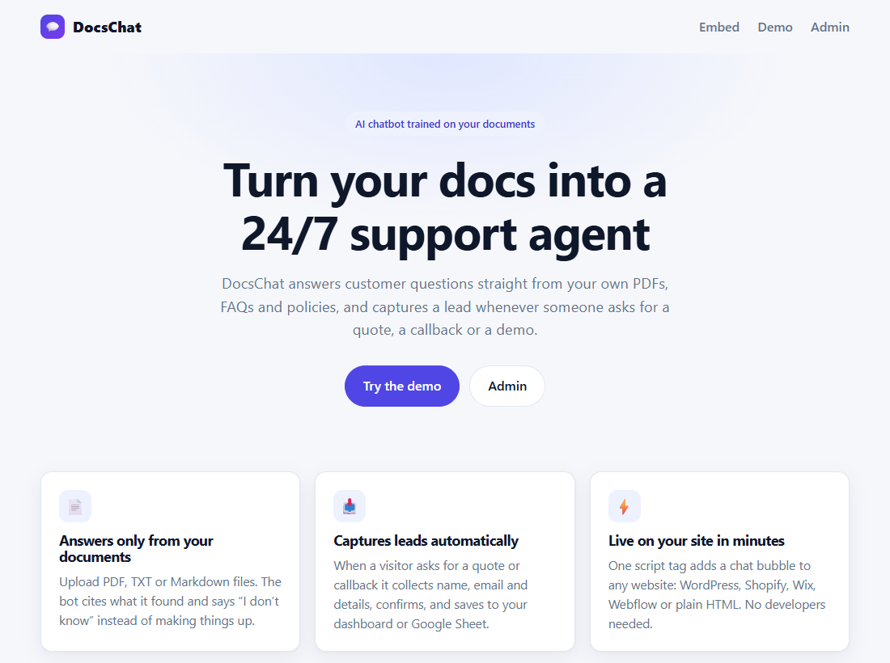
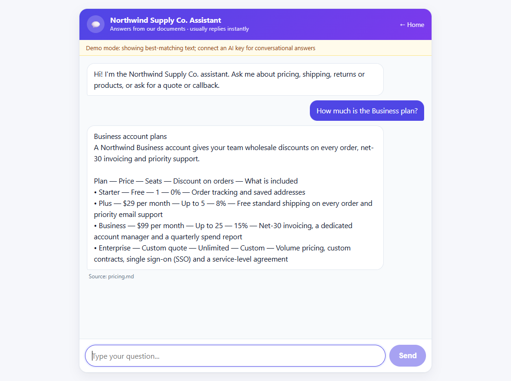
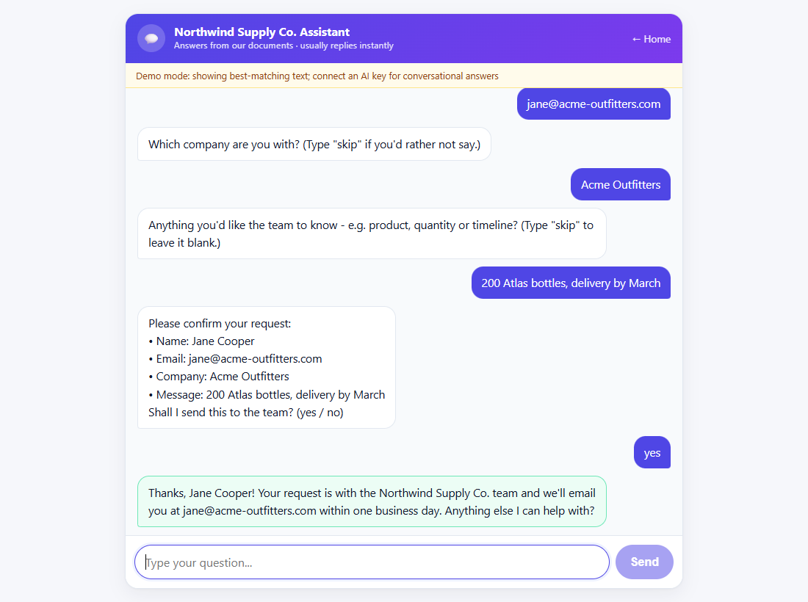
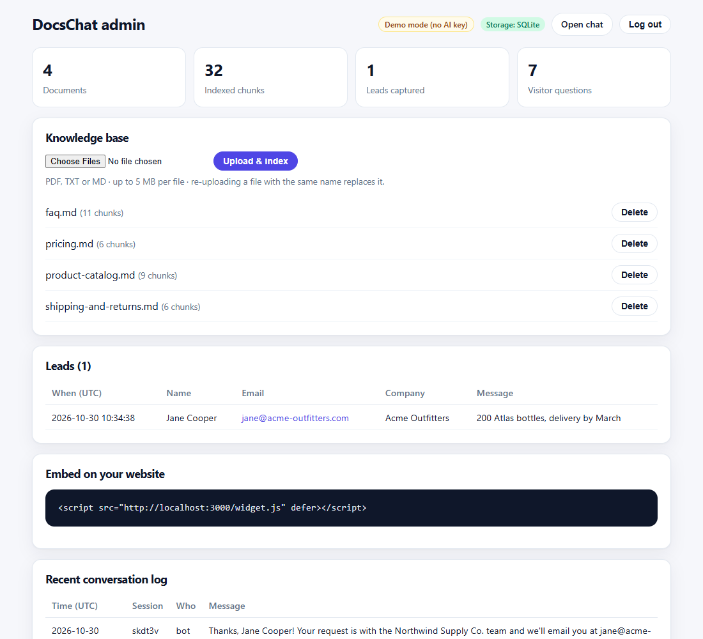
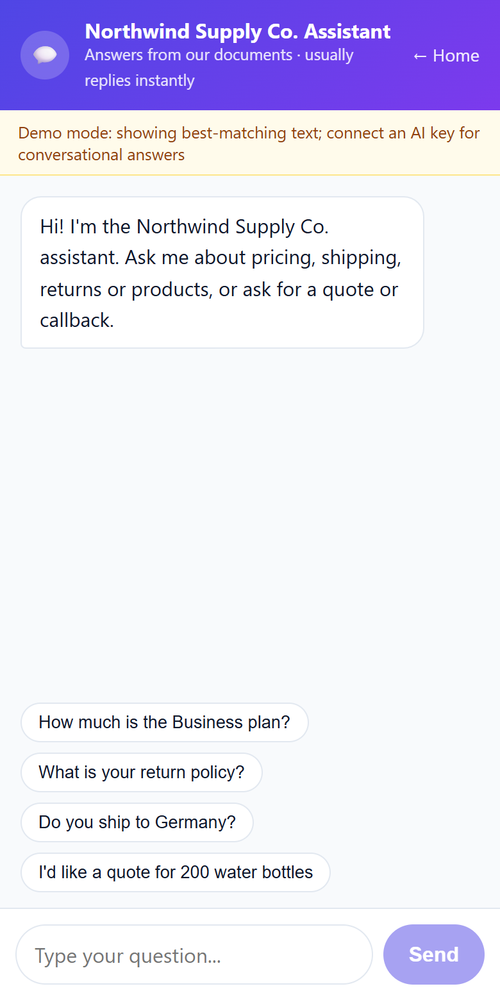

# DocsChat

**An AI chatbot trained on your own documents.** Upload your FAQs, price lists and policies; DocsChat answers customer questions from them 24/7, says "I don't know" instead of making things up, and captures a lead whenever someone asks for a quote, a callback or a demo. Embed it on any website with one line of code.

**Live demo:** <https://docschat-one.vercel.app> — chat at [/chat](https://docschat-one.vercel.app/chat); try "How much is the Business plan?" or "Can I return an opened item?"

> The live demo uses a fictional US store, **Northwind Supply Co.**, with sample pricing, shipping, returns and product documents (all prices in USD).

## The problem

Small businesses lose time and sales to the same repeated questions: "How much is the Business plan?", "What is your return policy?", "Do you ship to Canada?". Visitors who do not get an answer in seconds leave, and generic chatbots are worse than nothing because they invent prices and policies.

## What it does

- **Answers only from your documents.** Upload PDF, TXT or Markdown files. Every answer shows its source file as a small chip under the reply. If the answer is not in your documents, the bot says so in a highlighted "Not in the documents" panel, offers a human follow-up and a one-click "Request a callback" button instead of guessing.
- **Captures leads.** Ask for a quote, callback or demo and the bot collects name, email, optional company and message (the panel shows "Step 3 of 5" and Skip / Yes / No buttons), reads them back, asks for confirmation, then saves the lead to your admin dashboard (and optionally appends it to a Google Sheet).
- **A chat that is easy to use.** Suggested-question chips on an empty conversation, a typing indicator while the answer loads, Enter to send and Shift+Enter for a new line, auto-scroll, and an input bar that stays at the bottom on phones.
- **One-line website widget.** A floating chat button for WordPress, Shopify, Wix, Webflow or plain HTML. It is keyboard accessible, closes with Escape or its close button, and fills the screen on phones (under 480 px wide).
- **Admin dashboard.** Password-protected (with a show/hide password field): drag-and-drop document upload with the accepted types and limits stated, delete with a confirmation dialog, captured leads, the conversation log and a copy button for the embed code, each with a guided empty state.
- **Works without an AI key.** In *demo mode* it returns the best-matching passage from your documents (clearly labelled). Add an AI key (Groq or Gemini) and the same app gives natural, conversational answers.
- **Safe to leave public.** Chat rate limiting (20 requests/min/IP), 5 MB upload cap, PDF/TXT/MD only, admin behind a password, signed session cookie.

## Screenshots

| Landing page | Chat: answer from the documents |
|---|---|
|  |  |

| Chat: lead captured | Admin dashboard |
|---|---|
|  |  |

| Mobile |
|---|
|  |

Files expected in `docs/`: `screenshot-landing.png`, `screenshot-chat-answer.png`, `screenshot-chat-lead.png`, `screenshot-admin.png`, `screenshot-mobile-chat.png` (desktop shots are 1280x800, the mobile shot is 390x844). Re-take them with your own branding before sending the project to a client.

## How it works

```
 Admin uploads PDF / TXT / MD
        |
        v
  extract text -> split into heading-aware chunks -> (embed with Gemini, only if Gemini is the provider)
        |
        v
  SQLite (local)  or  Turso / libSQL (production)           <- one storage adapter, lib/db.ts
        ^
        |   top matching chunks
  Visitor question --> retrieval --+--> AI mode:   Groq (default) or Gemini answers ONLY from those chunks
                                   |               (temperature 0.1, fixed "I don't know" fallback)
                                   +--> Demo mode: best-matching text, trimmed and labelled (no AI key)
  "I'd like a quote" --> rule-based lead flow: name -> email -> company -> message -> confirm -> save
```

- **Provider selection** lives in one place, `lib/llm.ts`. `LLM_PROVIDER` can be `groq`, `gemini` or `none`; when it is empty the app picks Groq if `GROQ_API_KEY` is set, else Gemini if `GEMINI_API_KEY` is set, else none (demo mode). Naming a provider whose key is missing also means none. `/api/health` reports the active `provider` and `model`.
- **Retrieval.** With Gemini, chunks are embedded (`gemini-embedding-001`) and ranked by cosine similarity computed in plain code - no vector database to run or pay for; chunks indexed before the key was added are embedded automatically on the next question. With Groq (which has no embeddings endpoint) and in demo mode, a local BM25 keyword ranker with light stemming and synonyms is used.
- **AI answers.** Groq model `openai/gpt-oss-120b` (override with `GROQ_MODEL`; `openai/gpt-oss-20b` is faster and cheaper) through its OpenAI-compatible API, called with plain `fetch`; or Gemini `gemini-3.1-flash-lite` (override with `GEMINI_MODEL`). Both get the same strict prompt: answer only from the retrieved passages, temperature 0.1, say "I don't know" and give the fallback contact otherwise. Transient errors (429, 5xx, network) are retried with exponential backoff (Groq: 3 tries, about 1s then 2s; Gemini: 4 tries); if the model stays unavailable the visitor still gets the best-matching text from the documents (reported as `mode: "extractive"`). The demo-mode banner is shown only when no provider is configured.

#### Groq vs Gemini

- **Groq** (default): very fast, free tier (rate limited), one API key. Retrieval is keyword-based (BM25), so a question phrased with none of the document's words may miss; the synonym list covers common shop vocabulary.
- **Gemini** (optional): adds semantic embeddings, so paraphrased questions find the right passage. Free tier can return 503/429 under load (retried automatically).
- Set both keys and `LLM_PROVIDER=gemini` if you want Gemini even though a Groq key is present.
- **Lead capture is deliberately rule-based**, with or without an AI key. A small state machine cannot forget to ask for an email or invent a submission, and it validates the email address before saving.
- **Auto-seed.** On first start, if the database has no documents, the four sample documents are indexed automatically, so even an ephemeral deployment has something to demo.
- **Storage adapter.** Local development uses `better-sqlite3` (file in `./data`). Setting `TURSO_DATABASE_URL` switches to `@libsql/client` for a persistent hosted database. Application code never touches either driver directly.

## Run it locally

Requires Node.js 20 or newer.

```bash
npm install
cp .env.example .env        # Windows: copy .env.example .env
# edit .env: set ADMIN_PASSWORD (and optionally GROQ_API_KEY or GEMINI_API_KEY)
npm run dev                 # http://localhost:3000
```

| URL | What |
|---|---|
| `/` | Landing page: what it does, how it works, features and the copy-ready embed snippet |
| `/chat` | The chat (also what the widget loads) |
| `/admin` | Dashboard (log in with `ADMIN_PASSWORD`) |
| `/api/health` | JSON status: documents, storage, AI or demo mode, provider and model |

Other commands:

```bash
npm run build && npm start          # production build
npm run seed                        # re-index the sample documents
npm run verify                      # end-to-end smoke test against a running server
node scripts/verify.mjs https://your-app.vercel.app   # ...or against a deployed URL
node scripts/smoke-groq.mjs                           # one real question through a running app on Groq (needs GROQ_API_KEY)
```

`npm run verify` needs the same `ADMIN_PASSWORD` as the server (it reads `.env` automatically). It checks the pages, chat answers, the full lead flow, admin login protection, upload limits and rate limiting, and works in demo mode and in AI mode (Groq or Gemini).

### Embed on a website

```html
<script src="https://YOUR-DEPLOYMENT/widget.js" defer></script>
```

Paste it before `</body>`. The widget is a floating button (bottom-right, primary colour) that opens the `/chat` page in an iframe panel. The iframe loads on first hover, focus or click, so it costs the host page nothing until used. Escape or the close button closes the panel; under 480 px wide the panel fills the screen. The same snippet is on the landing page and in the admin, each with a copy button.

### Add your own documents

Log in at `/admin`, drop files on the **Documents** upload area or choose them (PDF, TXT or MD, up to 5 MB each, 5 files at a time), then click **Upload and index**. Deleting a document asks for confirmation first. Re-uploading a file with the same name replaces it. Delete the sample documents when you go live. Scanned PDFs without a text layer cannot be read (no OCR).

### Configuration

All settings are environment variables; see [.env.example](.env.example).

| Variable | Purpose |
|---|---|
| `ADMIN_PASSWORD` | Required. Admin stays locked while this is empty. |
| `LLM_PROVIDER` | Optional: `groq`, `gemini` or `none`. Empty = auto: Groq if `GROQ_API_KEY` is set, else Gemini if `GEMINI_API_KEY` is set, else none (demo mode). |
| `GROQ_API_KEY` | Optional. Enables conversational AI answers via Groq (keyword retrieval). |
| `GROQ_MODEL` | Default `openai/gpt-oss-120b` (alternative: `openai/gpt-oss-20b`). |
| `GROQ_BASE_URL` | Default `https://api.groq.com/openai/v1`. Override only for a proxy or a test server. |
| `GEMINI_API_KEY` | Optional. Enables conversational AI answers and semantic embeddings via Gemini. |
| `GEMINI_MODEL` | Default `gemini-3.1-flash-lite`. |
| `BUSINESS_NAME`, `BUSINESS_CONTACT` | Shown in the chat and used in the AI prompt and fallback message. |
| `TURSO_DATABASE_URL`, `TURSO_AUTH_TOKEN` | Persistent hosted storage (production). |
| `GOOGLE_SERVICE_ACCOUNT_JSON`, `SHEET_ID` | Optional: append each lead as a row to a Google Sheet (share the sheet with the service-account email). |
| `RATE_LIMIT_PER_MIN` | Chat requests per IP per minute (default 20). |

## Deploy

The recommended free setup is **Vercel + Turso** with a stable public URL. Exact click-by-click steps and the full environment variable list are in **[DEPLOY.md](DEPLOY.md)**.

## Limits and honest caveats

- **Demo mode is keyword matching, not understanding.** It shows the best-matching passage, not a composed answer. Connect an AI key for conversational replies.
- **Rate limiting is in-memory, per server instance.** It stops casual abuse of a public demo. A multi-instance production setup should put a shared store (Redis/Upstash) behind it.
- **Request size on Vercel.** Vercel caps request bodies at about 4.5 MB, so uploads on Vercel are effectively limited to that, below the 5 MB app cap.
- **Scale.** Retrieval reads all chunks per question, which is fine for hundreds of pages. For tens of thousands of chunks, move to a real vector index.
- **Single tenant.** One knowledge base and one admin password per deployment, no user accounts.
- **English only** for the lead-capture keywords and canned messages; the AI answers in the visitor's language when a key is set (with Groq, retrieval is keyword-based, so documents and questions should share a language).
- **No streaming**, and chat history is kept only while the page is open.
- **Privacy.** Conversations and leads are stored in your database. Add a privacy notice on the site where you embed it.
- **Not a human replacement for sensitive topics.** Medical, legal and financial answers should always link to a person.

## Tech stack

Next.js 15 (App Router) and TypeScript, React 19, plain CSS in one stylesheet with design tokens as CSS variables (no UI libraries; Inter via `next/font`, self-hosted at build time), `better-sqlite3` / `@libsql/client` (Turso), Groq via plain `fetch` (OpenAI-compatible API), `@google/genai` (optional Gemini), `google-auth-library` (optional Sheets), `pdf-parse`.

## Project layout

```
app/            pages (/, /chat, /admin, /admin/login), shared components (app/components) and API routes (chat, docs, admin, health); globals.css holds all styles
public/         widget.js (embed script), favicon.svg, og.png (link-preview image)
lib/            db adapter, retrieval (rag.ts), provider selection + Groq/Gemini calls with retry (llm.ts), lead flow, auth, rate limit
sample_docs/    the Northwind Supply Co. demo documents (auto-seeded)
scripts/        verify.mjs (smoke test), smoke-groq.mjs (one real Groq question), seed.ts, embed-samples.mjs
```

## License

MIT - see [LICENSE](LICENSE).

---

Built by Shivam Kumar Yadav · sak23571113@gmail.com · github.com/shivam911898
